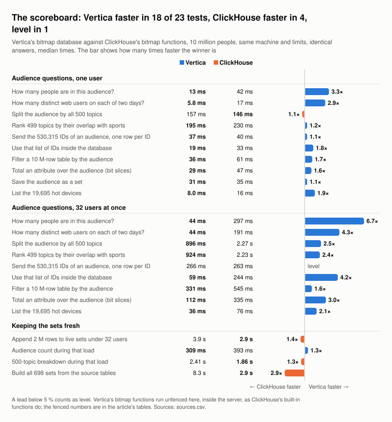

# vertica-bitmap-udx: the bitmap database inside Vertica

**Vertica is an analytical database with a wide range of functionalities, including
high-performance bitmap capabilities that answer audience questions up to 6.7 times faster than
ClickHouse's own bitmap functions. This repository serves as the proof, and provides the means to
reproduce the results.**

Every vendor says "we can do that too". Here the sentence was put to a test it could fail: 299
recorded benchmark runs on one machine, with identical data, limits and answers.

- **The same question, the same Vertica, 53 times faster.** An exact audience count over 10 million
  people and 200 million interest rows takes Vertica's tuned plain SQL 666 ms. With this extension
  Vertica answers in 13 ms.
- **Faster than the specialist.** ClickHouse's built-in bitmap functions answer that count in
  42 ms, and in 297 ms when 32 users ask at once. Vertica: 13 ms and 44 ms, 3.3 and 6.7 times
  faster. Of 19 audience tests against ClickHouse's bitmaps, Vertica is faster in 17 and level in
  one.
- **No second engine, no copy of the data, no pipeline.** The sets live in the Vertica that
  already runs the rest of your analytics.



Blue is Vertica, orange is ClickHouse; the bar points to the faster engine. ClickHouse is faster
in 4 of the 23 tests (building and appending to the sets, and the 500-topic breakdown in two
situations); every one of them is in the article with its number. The whole story, test by test, with side by side charts:
[blog/BLOG.md](blog/BLOG.md).

`vbitmap` is a C++ extension (UDx) built on [CRoaring](https://github.com/RoaringBitmap/CRoaring)
that keeps compressed sets of entity IDs in ordinary Vertica tables and answers audience counts,
facet breakdowns, overlaps, distinct counts and ID lists with set algebra instead of joins.

Two ways to keep the sets:

- a **snapshot lifecycle** that builds an index, validates every set against its source and
  publishes it in one transaction, with incremental refresh and rollback;
- a **live index**: a live aggregate projection that calls the library's functions, so that Vertica
  itself updates the sets with every load, inside the load's transaction.

Plain SQL stays the reference: every bitmap answer in the tests and the benchmark is checked
against it.

Companion extensions built the same way, as C++ functions called from SQL: `vertica-graph-udx`
(graph analytics) and `vertica-vector-db` (vector search). This one adds the bitmap database.

License: MIT (see `LICENSE`).

## What is in the box

Vertica can be extended: a function written in C++ against Vertica's SDK is compiled into a shared
library and loaded with one `CREATE LIBRARY` statement. From then on it is part of the engine. It
is called from SQL like `COUNT` or `SUM`, runs in parallel inside the query, and every user who is
granted it can call it from any client. Vertica calls such a function a UDx.

`vbitmap` is **one library, 24 SQL functions and a handful of scripts**. Storage, parallel
execution, security and transactions come from Vertica; the extension adds the set arithmetic.

### The idea in three steps

1. **Describe each condition as a query.** A catalog table (`bitmap_demo.bitmap_family`) holds one
   SQL query per family of conditions. The query returns pairs of (condition name, entity ID):
   the family "topic", for example, returns `('topic_sports', 4711)` for every person who likes
   sports. Your own conditions are added the same way.
2. **Build the sets.** For every condition and every block of 65,536 IDs (a "chunk"), a function
   compresses the IDs into one Roaring set and stores it as one row of an ordinary Vertica table:
   `(predicate, chunk_id, payload)`. A payload is at most 8,208 bytes in a `VARBINARY(16384)`
   column, any 64-bit ID works, and on a cluster the work spreads over the nodes by chunk.
3. **Ask with an expression.** A question is the names of the conditions joined by `&` (and),
   `|` (or), `-` (and not), `^` (one or the other, not both) and parentheses. One function call
   evaluates the whole expression in a single pass over the sets:

   ```sql
   SELECT SUM(cnt) FROM (
     SELECT vbitmap.bm_count(chunk_id, predicate, payload USING PARAMETERS expr =
              'country_IL & age_25_54 & consent_true & suspended_false & (topic_sports | topic_finance)')
            OVER (PARTITION BY chunk_id)
     FROM bitmap_demo.v_bitmap_index
     WHERE tenant_id = 10 AND domain = 'person'
       AND snapshot_id = (SELECT snapshot_id FROM bitmap_demo.v_bitmap_snapshot
                          WHERE tenant_id = 10 AND domain = 'person' AND state = 'active')
       AND predicate IN ('country_IL','age_25_54','consent_true','suspended_false','topic_sports','topic_finance')) t;
   ```

   The same question from the shell:
   `scripts/bmq --tenant=10 'country_IL & age_25_54 & consent_true & suspended_false & (topic_sports | topic_finance)'`.
   (The condition names are those of the demo data, where `country_IL` is the set of one country.)

### The functions

All 24 live in schema `vbitmap`. They come in five small groups.

**1. Asking questions.** These five read the index rows `(chunk_id, predicate, payload)` and take
the question as the parameter `expr`. Each is called `OVER (PARTITION BY chunk_id)`.

| Function | How you call it | What it gives you |
|---|---|---|
| `bm_count` | `bm_count(chunk_id, predicate, payload USING PARAMETERS expr='...')` | **How many.** The number of members in each chunk; add them up with `SUM` |
| `bm_ids` | `bm_ids(chunk_id, predicate, payload USING PARAMETERS expr='...' [, max_ids=N] [, text=true])` | **Who.** One row per member ID: as an integer for joins and `INSERT ... SELECT`, or with `text=true` as text, the faster form for sending rows to a client |
| `bm_ids_text` | `bm_ids_text(chunk_id, predicate, payload USING PARAMETERS expr='...' [, sep=E'\n'])` | **Who, in bulk.** The same list as text blocks of up to 65,000 bytes, one ID per line: the fastest way to hand a long list to a client |
| `bm_facets` | `bm_facets(chunk_id, predicate, payload USING PARAMETERS expr='...', facets='topic_' [, exclude='topic_'])` | **The breakdown.** The size of the audience inside every set whose name starts with the prefix (all 500 topics, for example), in the same single pass |
| `bm_eval` | `bm_eval(chunk_id, predicate, payload USING PARAMETERS expr='...')` | **The audience itself**, as a set per chunk, to store and use as a condition later |

**2. Building sets.**

| Function | How you call it | What it does |
|---|---|---|
| `bm_build` | `bm_build(key_1, ..., key_n, local_id) OVER (PARTITION BY key_1, ..., key_n)` | Makes one set from the IDs of each group of rows (`local_id` is the ID inside its chunk: `entity_id & 65535`). Runs fenced or unfenced |
| `bm_union` | `bm_union(key_1, ..., key_n, payload) OVER (PARTITION BY key_1, ..., key_n)` | Merges many sets into one: the days of a week, or the pieces of a live index |
| `bm_build_agg` | `SELECT ..., bm_build_agg(local_id) ... GROUP BY ...` | The same set as `bm_build`, written as an aggregate: Vertica groups on every thread without sorting. This is the fast builder (unfenced deployments) |
| `bm_union_agg` | `SELECT ..., bm_union_agg(payload) ... GROUP BY ...` | The aggregate form of `bm_union` (unfenced deployments) |

**3. Working with stored sets directly.**

| Function | How you call it | What it does |
|---|---|---|
| `bm_and`, `bm_or`, `bm_xor`, `bm_andnot` | `bm_and(a, b)` | The set operation on two stored sets; the result is a set |
| `bm_cardinality` | `bm_cardinality(a)` | The size of a set |
| `bm_and_cardinality` | `bm_and_cardinality(a, b)` | The size of an intersection, without building it |
| `bm_contains` | `bm_contains(a, local_id)` | Is this ID in the set? |
| `bm_to_ids` | `bm_to_ids(chunk_id, payload) OVER (PARTITION ROW)` | The members of a stored set, one row per ID |
| `bm_pair_count` | `bm_pair_count(name, a, b) OVER (PARTITION BEST)` | The intersection count of each pair of sets. Its rows are independent, so Vertica spreads them over every thread of the query: breakdowns for a single user who has the whole machine |

**4. An audience as a filter on any table (pinned sets).**

| Function | How you call it | What it does |
|---|---|---|
| `bm_pin` | `bm_pin(chunk_id, predicate, payload USING PARAMETERS expr='...', name='aud') OVER ()` | Evaluates the question and keeps the audience in memory for the session, under a name. A second form, `bm_pin(chunk_id, payload USING PARAMETERS name='aud') OVER ()`, pins a set that is already stored |
| `bm_member` | `... WHERE bm_member(entity_id USING PARAMETERS name='aud')` | Tests every row of any table against the pinned audience while the table is scanned, on every thread. No ID list and no join: this is how an audience meets columns that are not indexed |
| `bm_unpin` | `bm_unpin('aud')` | Releases the pinned set |

**5. Housekeeping.** `bm_empty(USING PARAMETERS chunk_bits=16)` returns the empty set,
`bm_info(a)` describes a stored set (format, size, bytes), and `bm_version()` reports the library
and its build.

### The programs

| Program | How you run it | What it does |
|---|---|---|
| `make`, `make deploy` | `make && make deploy` (`make deploy FENCED=no` for unfenced; `scripts/deploy.sh --undeploy` removes everything) | Compiles the library and installs the functions with `CREATE LIBRARY` |
| `scripts/snapshot.sh` | `scripts/snapshot.sh build --tenant=N --domain=person --watermark='...' --daily --publish`; also `apply`, `validate`, `publish`, `purge`, `discard`, `status` | The validated index: builds a snapshot, checks every set against its source, publishes it in one transaction, applies change batches, rolls back |
| `scripts/live_index.sh` | `scripts/live_index.sh create`, then `load --tenant=N`; also `projections`, `status`, `drop` | The live index: tables whose live aggregate projections hold the sets, so every load keeps them current |
| `scripts/bmq` | `scripts/bmq --tenant=N 'EXPRESSION'` with `--mode=count`, `--mode=ids` or `--mode=facets --facets=topic_` | Asks a question from the shell. `--echo_only` prints the SQL it would run; `--mode=native-count` answers the same question from the source tables, as a check |
| `scripts/generate.sh` | `scripts/generate.sh --tenant=N --snapshot=1 --small` (or `--default`, `--large`) | Seeded test data, generated inside Vertica: 1, 10 or 100 million people |
| `scripts/demo.sh` | `scripts/demo.sh` (`--size=default` for 10 M people, `--pause` for a presentation) | The five-minute tour: build, query, breakdown, IDs, refresh, rollback |
| `make test`, `tests/sql/run_all.sh` | as written | The engine's unit tests, and eight SQL test suites that run with the functions fenced and unfenced |
| `bench/reproduce.sh` | `bench/reproduce.sh --size=small --no-limits`, or with no option for the article's protocol | Measures the bitmap benchmark of this article again, from an empty tenant to a report |

### Good to know

- **Fenced or unfenced.** `make deploy` installs the functions fenced: they run in a separate
  process and a fault cannot stop the node. `make deploy FENCED=no` runs them inside Vertica,
  which is up to 2.5 times faster on short queries for one user and up to 4.3 times with 32
  concurrent users. Both pass the same tests. Vertica runs user-defined aggregates inside the
  server only, so `bm_build_agg` and `bm_union_agg` exist in the unfenced deployment.
- **Sets in tables.** One row per (tenant, snapshot, domain, predicate, ID chunk of 65,536 IDs),
  payload at most 8,208 bytes (`VARBINARY(16384)`, format in [docs/FORMAT.md](docs/FORMAT.md)).
- **Snapshot lifecycle** ([docs/LIFECYCLE.md](docs/LIFECYCLE.md)): build, validate against the
  source, publish atomically, pin, roll back, purge; incremental apply of change batches
  (touch / add / remove); readers see views filtered by tenant and role. The aggregate builder
  (`--aggregate`, unfenced) builds the sets of 10 million people in 7.6 s instead of 72 s.
- **Live index** ([docs/LIVE.md](docs/LIVE.md)): every `INSERT` or `COPY` keeps the sets exact.
  For facts that are only added (the anchor table accepts no UPDATE or DELETE).
- **Pinned sets** ([docs/PINNED.md](docs/PINNED.md)): an audience meets a 10-million-row table in
  36 ms where the semi-join with its ID list takes 123 ms (unfenced).
- **Numeric attributes as bit slices** (`sql/families_bitsliced.sql`): one set per bit of a value
  (`age_bit_0` ... `age_bit_7`). The size of an audience, the number of its members with a known age
  and the sum of their ages then come from set counts in one `bm_facets` pass, with no join to the
  profile table (`sql/queries/q9/bitsliced.sql`); the same sets serve as range predicates
  (`age_known - age_bit_6 - age_bit_7`: younger than 64).

## Requirements

- Vertica 26.3 with its C++ SDK (`/opt/vertica/sdk`), run on a Vertica node (developed and measured on
  26.3.0-2, single node, Ubuntu 26.04).
- g++ with C++17 (built with g++ 15.2 and g++ 8.5), GNU make, bash, bc, Python 3.6 or later
  (standard library only, for the benchmark driver).
- A database user allowed to create libraries and functions (a superuser for `sql/access.sql`).
- Connection through the usual `VSQL_HOST`, `VSQL_PORT`, `VSQL_USER`, `VSQL_PASSWORD`,
  `VSQL_DATABASE` environment variables.

## Build, test, install

```bash
make                 # build/libvbitmap.so (CRoaring 5.5.5 is vendored in third_party/croaring)
make tools           # build/bmexpr, used by scripts/bmq
make test            # engine unit tests; make asan: the same with AddressSanitizer + UBSan
make deploy          # CREATE LIBRARY + the functions, fenced (FENCED=no: unfenced, with the two aggregates)
tests/sql/run_all.sh # eight SQL test suites, fenced and unfenced (drops and recreates schemas bitmap_demo and bitmap_live!)
```

## Five-minute demo

```bash
scripts/demo.sh                  # 1 M people on tenant 100: build, query, facets, refresh, rollback
scripts/demo.sh --size=default   # 10 M people, the benchmark's size
scripts/demo.sh --pause          # wait for Enter between steps (presentations)
```

The demo creates schema `bitmap_demo` if it is missing, never drops it, and removes its tenant at the
end (`--keep` to leave it).

## Your own data

1. Load source rows into the tables of `sql/schema.sql` (or adapt them), with a `tenant_id` and a
   `snapshot_id` per load.
2. Describe each predicate family as a query returning `(predicate, entity_id)` in
   `bitmap_demo.bitmap_family` (examples: `sql/families.sql`).
3. Build and publish: `scripts/snapshot.sh build --tenant=N --domain=person --watermark='...' --daily --publish`
   (unfenced deployments: add `--aggregate --pool=POOL` for the fast builder, see
   [docs/LIFECYCLE.md](docs/LIFECYCLE.md)).
4. Later loads: report changes as a batch in `bitmap_demo.bitmap_change` and run
   `scripts/snapshot.sh apply --tenant=N --domain=person --batch=B --source-snapshot=S --publish`.
5. Give readers `sql/access.sql`'s role and a row in `bitmap_demo.bitmap_reader`.
6. Facts that are only ever added (tags, interests, events) need none of the steps above: give their
   table a live projection (`sql/live_projections.sql` is the pattern) and query it by its name.
7. For facet breakdowns and many concurrent users add the second projection of the index, sorted by
   chunk (`bench/vertica_projection_bychunk.sql`): expressions are then evaluated chunk by chunk
   without a sort (facets at 32 clients: 14.4 s -> 3.5 s in the benchmark). It stores the index twice.

## Measure it yourself

Two entry points measure what the article, the video and this page present. Each one runs on
its own, prints every command it starts and keeps the raw files of every run.

| What | Command | Where the result goes |
|---|---|---|
| The idea in five minutes: build, query, refresh, roll back | `scripts/demo.sh` | the terminal |
| The bitmap benchmark: native SQL, the index fenced and unfenced, ID lists, refresh, ClickHouse | `bench/reproduce.sh` | `~/bitmap_reproduce/REPORT.md` and one folder per run |

```bash
export VSQL_DATABASE=<database>                 # on a Vertica 26.3 node, as the database administrator
bench/reproduce.sh --size=small --no-limits     # a first try: 1 M people, a few minutes per step
bench/reproduce.sh                              # the article's protocol: 10 M people, engine limited to 20 CPUs and 56 GiB
bench/reproduce.sh --size=large data index bitmap report   # 100 M people, the bitmap paths
bench/reproduce.sh live --replace-live          # the live index (owns schema bitmap_live)
```

`bench/reproduce.sh --help` lists the steps and options. The steps follow the article:

| Step | Article section |
|---|---|
| `data`, `index` | "What the index costs": build, validation, storage |
| `native` | "Test one", the plain SQL columns: hand-tuned projections and the Database Designer's, the faster one reported |
| `bitmap` | "Test one", "Test two" and "Test three" (Vertica's columns, fenced and unfenced), "One user, every thread"; the aggregate builder |
| `refresh` | "What the index costs": incremental refresh |
| `live` | "Test four: fresh data, and the index that maintains itself" |
| `clickhouse` | ClickHouse's columns of "Test two", "Test three" and "Test four" |
| `report` | one Markdown report of all of it |

Your numbers will differ with your hardware; the answers will not: every execution of every path
is compared with native SQL, and ClickHouse's answers with Vertica's.

The script is tested end to end on the article's machine (Ubuntu 26.04, g++ 15, Python 3.14) and,
with `--size=small --no-limits`, on a much smaller one: a five-node Eon-mode database with a
password on a host with 2 CPUs and 16 GB of memory (RHEL 8, g++ 8.5, Python 3.6), where every
Vertica step ran and every answer matched. On several nodes the script leaves out one test, the
row filter on a pinned set, which is made for one node (`docs/PINNED.md`). On a machine with less
than 40 GB give `--build-memory` (for example `60%`).

## Benchmark

`bench/` holds everything used for the published numbers: the reproduction script above
(`reproduce.sh`), CPU and memory limits for the engine under
test (`limits.sh`, cgroup scope), the recorded-run wrapper (`record.sh`), the driver (`driver.py`:
concurrent clients, answer check of every execution, engine times, a time limit per statement; it
reads Vertica through `vsql` or, with `--client=socket`, as raw bytes from the socket, the way it
reads ClickHouse), workloads for Vertica and ClickHouse (`workloads/`), the ClickHouse setup
(`engines/clickhouse/`, `ch.sh`), refresh (`refresh.sh`, `live_append.sh`), the Database Designer
comparison (`dbd.sh`), copies of the index with another payload encoding
(`encoding_copy.sh`), the exact command
sequences of every published measurement as they ran (`chains/`, with a progress script that reads
log files only) and the
chart generator (`charts.py`, specification written by `blog/charts/make_spec.py`: every bar, every
"times faster" and the scoreboard are computed from the recorded runs).
Data: `scripts/generate.sh --small | --default | --large` (seeded; same rows on any database).

`results/` holds the raw files of every run the article cites (timings of each execution, answer
hashes, plans, settings, versions), copied from the complete record of the project;
`results/INDEX.md` lists them by the run numbers used in the article.

## Layout

| Path | Content |
|---|---|
| `src/engine` | set library: chunked bitmaps, payload codec, CRC-32C, expression parser |
| `src/udx` | Vertica functions |
| `sql/` | schema, families, fixture, access role, generators, demo queries |
| `scripts/` | deploy, snapshot lifecycle, bmq, generator, demo |
| `tests/` | engine tests, fuzz targets, SQL tests, SDK probes |
| `bench/` | benchmark harness |
| `docs/` | payload format, lifecycle, live index, pinned sets |
| `blog/` | the article with the benchmark results, its charts, the video storyboard and narration |
| `results/` | raw files of the runs cited by the article |

## Limits

- Measured on a single node. The tables are segmented by chunk for a cluster; multi-node behaviour is
  not measured.
- Chunks of 2^16 IDs (`--chunk-bits` 8 to 16 in the lifecycle tables).
- Predicates are defined and built in advance; numeric attributes use precomputed bands or bit
  slices.
- Pinned sets live in the memory of the process that pinned them: one node. On a cluster use the
  semi-join with the ID list.
- The live index is for append-only tables (rows are added, never updated or deleted) and is at its
  best with the functions unfenced.
- `tests/sql/run_all.sh` drops schemas `bitmap_demo` and `bitmap_live`; run it on a test database.

## Disclaimer

This work is a demonstration. It is not an official product or functionality offered by Rocket
Software, and it is provided "as is", without warranties of any kind. All brands and product names,
including Vertica and ClickHouse, are mentioned for reference only and belong to their respective
owners.
