# The Bitmap Database Inside Vertica Answers Faster Than ClickHouse's Own Bitmaps. We Measured Everything.

*Every vendor says "we can do that too". We put one such sentence to a test it could fail: 299
recorded benchmark runs on one machine, with identical data, limits and answers. The result:
Vertica, an analytical database with a wide range of capabilities, gains high-performance bitmap
capabilities from a small extension and answers audience questions up to 6.7
times faster than ClickHouse's built-in bitmap functions.*

<!-- Every number below comes from a recorded run; the run number (results/INDEX.md) is given in a
     comment next to it. The numbers in the chart titles and the scoreboard table are computed by
     bench/charts.py from the same runs (blog/charts/sources.csv). -->

## The claim

Database vendors have a favourite sentence: *we can do that too.* Graphs, vectors, time series,
bitmaps: one platform for everything. The sentence costs nothing to say, and it is almost never
checked.

This article checks it for one job. Audience analytics, the "how many people match these filters,
and who are they?" questions behind every marketing screen, is the classic work of a bitmap
database. The job usually goes to a specialised engine installed next to the warehouse, and
ClickHouse is the obvious choice: it is fast, it is popular, and its Roaring bitmap functions are
part of the product.

The claim we set out to test has two parts, and either one could fail:

1. **Vertica can do the job itself**, inside the database you already run, with its own SQL,
   security and transactions.
2. **Vertica is the faster choice**, measured against ClickHouse's own bitmap functions on the
   same machine, the same data and the same limits.

We wanted a conclusion that nobody could argue with, so we measured everything: six kinds of
question, for one user and for 32 users at once; the list of people behind a count, in seven
different uses; fresh data arriving while users query; and ten times the data. 299 runs are in
the record. Every one was kept, including the runs that failed and the tests that Vertica lost.
<!-- benchmark record, INDEX rows 1-299 -->

The evidence turned against the claim more than once. ClickHouse's plain SQL answered the first
question three times faster than Vertica's plain SQL. The first test of ID lists went to
ClickHouse by a wide margin. An early breakdown test took fourteen seconds. Each time we looked
for the cause, and each cause turned out to be worth knowing.

Here is the outcome in one figure. The rest of the article is how we got there.

## The scoreboard

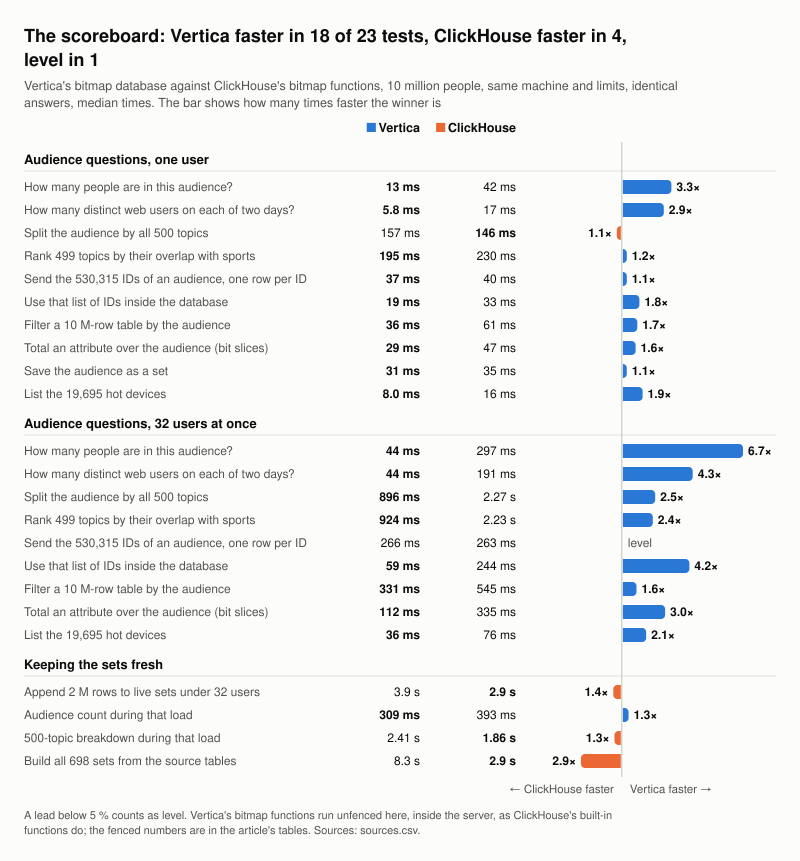

How to read it: every row is one test, run on both engines. Blue is Vertica, orange is ClickHouse,
in this figure and in every other one. The bar points to the faster engine and is as long as its
lead. A lead below 5 % counts as level.

| Test | Vertica | ClickHouse | Faster |
|---|---:|---:|---|
| **Audience questions, one user** | | | |
| How many people are in this audience? | **13 ms** | 42 ms | **Vertica, 3.3×** |
| How many distinct web users on each of two days? | **5.8 ms** | 17 ms | **Vertica, 2.9×** |
| Split the audience by all 500 topics | 157 ms | **146 ms** | ClickHouse, 1.1× |
| Rank 499 topics by their overlap with sports | **195 ms** | 230 ms | **Vertica, 1.2×** |
| Send the 530,315 IDs of an audience, one row per ID | **37 ms** | 40 ms | **Vertica, 1.1×** |
| Use that list of IDs inside the database | **19 ms** | 33 ms | **Vertica, 1.8×** |
| Filter a 10 M-row table by the audience | **36 ms** | 61 ms | **Vertica, 1.7×** |
| Total an attribute over the audience (bit slices) | **29 ms** | 47 ms | **Vertica, 1.6×** |
| Save the audience as a set | **31 ms** | 35 ms | **Vertica, 1.1×** |
| List the 19,695 hot devices | **8.0 ms** | 16 ms | **Vertica, 1.9×** |
| **Audience questions, 32 users at once** | | | |
| How many people are in this audience? | **44 ms** | 297 ms | **Vertica, 6.7×** |
| How many distinct web users on each of two days? | **44 ms** | 191 ms | **Vertica, 4.3×** |
| Split the audience by all 500 topics | **896 ms** | 2.27 s | **Vertica, 2.5×** |
| Rank 499 topics by their overlap with sports | **924 ms** | 2.23 s | **Vertica, 2.4×** |
| Send the 530,315 IDs of an audience, one row per ID | 266 ms | 263 ms | level |
| Use that list of IDs inside the database | **59 ms** | 244 ms | **Vertica, 4.2×** |
| Filter a 10 M-row table by the audience | **331 ms** | 545 ms | **Vertica, 1.6×** |
| Total an attribute over the audience (bit slices) | **112 ms** | 335 ms | **Vertica, 3.0×** |
| List the 19,695 hot devices | **36 ms** | 76 ms | **Vertica, 2.1×** |
| **Keeping the sets fresh** | | | |
| Append 2 M rows to live sets under 32 users | 3.9 s | **2.9 s** | ClickHouse, 1.4× |
| Audience count during that load | **309 ms** | 393 ms | **Vertica, 1.3×** |
| 500-topic breakdown during that load | 2.41 s | **1.86 s** | ClickHouse, 1.3× |
| Build all 698 sets from the source tables | 8.3 s | **2.9 s** | ClickHouse, 2.9× |

<!-- The table is blog/charts/scoreboard.md, written by bench/charts.py. Audience tests: Vertica's
     bitmap functions unfenced against ClickHouse's bitmap functions, 10 M people. Vertica runs 170,
     171, 172, 174, 187, 210, middle of 222 / 278 / 293 (one row per ID) and of 223 / 279 / 294 (row
     filter); ClickHouse runs 103, 133, 134, 154, 216, 234, 235. Fresh data: runs 179, 138; build:
     runs 239, 240, 236, 237. -->

**Vertica is faster in 18 of the 23 tests, ClickHouse in 4, and 1 is level.** On the 19 audience
questions, the job a bitmap engine is bought for, Vertica is faster in 17. ClickHouse is faster at
building and appending to the sets and at the 500-topic breakdown in two situations. Every one of
those results is in this article, with its number.

## The short version

- **The same question, the same Vertica, 53 times faster.** "How many consenting, active users in
  the country, aged 25 to 54, like sports or finance?" takes Vertica's tuned plain SQL 666 ms on 10
  million people and 200 million interest rows. Vertica's bitmap database answers in 13 ms, with
  exactly the same number (31 ms with the functions fenced). <!-- runs 170, 157; plain SQL run 40 -->
- **Three times faster than ClickHouse's bitmaps; 6.7 times with 32 users.** ClickHouse's bitmap
  functions answer that count in 42 ms for one user and 297 ms when 32 users ask at once.
  Vertica's bitmap database: 13 ms and 44 ms. <!-- runs 170, 103 -->
- **Ahead of ClickHouse in 17 of 19 audience tests**, level in one. ClickHouse is ahead in one:
  the 500-topic breakdown for a single user, 146 ms against Vertica's 157 ms.
  <!-- scoreboard; runs 103, 187 -->
- **The list of people is faster in Vertica too.** The 530,315 IDs of an audience, used inside the
  database: Vertica 19 ms, ClickHouse 33 ms. As a filter on a 10-million-row table: Vertica 36 ms,
  ClickHouse 61 ms. Sent to a user one row per ID: Vertica 37 ms, ClickHouse 40 ms.
  <!-- runs 172, 133; middle of 223, 279, 294 and run 235; middle of 222, 278, 293 and run 234 -->
- **The index can maintain itself.** Declared as a live aggregate projection, the sets are kept up
  to date by Vertica inside the transaction of every load. Two million new rows were queryable,
  exactly, 3.9 s after the append began, while 32 users kept querying. ClickHouse's live sets took
  the same rows in 2.9 s. <!-- runs 179, 138 -->
- **ClickHouse builds the sets faster:** 2.9 s against Vertica's 8.3 s.
  <!-- runs 236, 237, 239, 240 -->
- **It holds at ten times the data.** At 100 million people Vertica's bitmap database answers the
  count in 59 ms where Vertica's plain SQL takes 10.3 s, and an overlap ranking that takes plain
  SQL 29 minutes takes 10 s. <!-- runs 203, 205, 82, 81 -->
- **One system instead of two.** The sets are rows in Vertica tables, validated against their
  source and published in a transaction. There is no second engine, no copy of the data and no
  pipeline.

## The question that hurts

A marketer builds an audience: people in the country, aged 25 to 54, who gave consent, whose account is
not suspended, and who like sports or finance. How many are there? She changes one filter and asks
again. And again.

Marketing platforms, product analytics, IoT fleets and data governance tools all ask this kind of
question all day: *which entities satisfy this combination of conditions, how many are there, and
how does the group break down?* An audience is built from a dozen attributes and hundreds of
interest tags, and the analyst expects the count back before the cursor moves.

In plain SQL every such question is a new set of joins, semi-joins and `COUNT(DISTINCT ...)` over
hundreds of millions of membership rows. A columnar engine like Vertica does that well for one
user: 666 ms for the marketer's count, on projections chosen by Vertica's own Database Designer.
Give the same screen to 32 analysts at once and the same answer takes 3.6 s. It gets harder still
when IDs are not neatly ordered, and when the answer is a breakdown or an overlap ranking rather
than one number. <!-- runs 40, 41 -->

## The old trick: sets instead of rows

A bitmap database turns every condition into a **set of entity IDs** and every question into
**set algebra**. "Lives in the country" is a set. "Likes sports" is a set. "Lives in the country and
likes sports but not finance" is an intersection followed by a difference, and the answer to "how many"
is the size of the result.

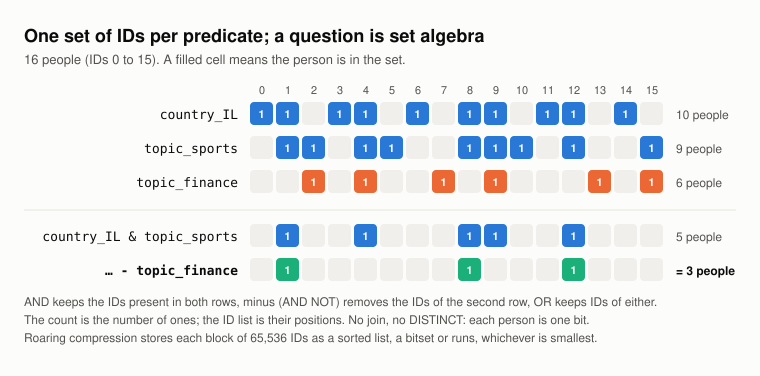

Three properties make this the right tool for audience analytics:

- **The cost follows the number of conditions, not the number of rows.** Combining six sets over
  10 million people touches a few megabytes of compressed bits, whatever the tables behind them hold.
- **Counts are exact and distinct by construction.** A person is one bit, however many interest or
  event rows they have. Sets of different days can be united and counted without double counting,
  which a table of daily totals cannot do.
- **Compression adapts to the data.** The Roaring format stores each block of 65,536 IDs as a short
  sorted list when it is sparse, a plain bitset when it is dense and run lengths when IDs come in
  ranges, and the set operations work directly on those forms.

The price is that the sets must exist before the question is asked. They are an index, and like any
index they have to be built, stored, refreshed and kept consistent with the data they describe.

## The specialist next door

This is why companies buy a second system: a bitmap engine next to the warehouse (ClickHouse with
`groupBitmap`, Apache Druid, Pinot, or a home-grown Redis service). The price is not the licence.
It is a copy of the data, a pipeline that keeps the copy in step, a second security model and a
second thing to operate.

Before adding anything, we looked at what Vertica 26.3 already offers for the job. Each option was
examined on the installed server before the design was fixed:

| Option | What it gives | Why it was or was not chosen |
|---|---|---|
| Plain SQL on tuned projections | Exact, no extra objects, the optimizer does the work | The baseline and the correctness reference of every test; its cost grows with the rows behind each condition |
| Approximate distinct counts (`APPROXIMATE_COUNT_DISTINCT` and its synopsis functions) | Built in, small, mergeable | Counts only and approximate (0.36 % off on the two-day count here); no intersections, no ID lists |
| Raw bitsets in `VARBINARY` with the built-in `&`, `\|`, `~`, `BIT_AND`, `BIT_OR` and `BITCOUNT` | Set algebra with no extension at all | No compression: every (condition, chunk) costs the full 8 KB however sparse it is, which 500 topics make expensive; a valid alternative for a few dense conditions, not measured here |
| **Roaring sets in ordinary tables, C++ scalar and transform functions (UDx)** | Compressed sets, any 64-bit ID, runs fenced or unfenced, one pass per chunk for a whole expression | **Chosen** |
| C++ aggregate functions | The most natural SQL (`GROUP BY` with a set aggregate) | Vertica runs user-defined aggregates unfenced only, so the safe fenced mode would be lost |
| **A live aggregate projection that calls the same C++ functions** | Vertica itself keeps the sets current on every load, inside the load's transaction: an index with no build job | **Chosen as the second form**, for data that is only ever added (its table is append-only) |
| A separate bitmap engine next to Vertica (ClickHouse, Druid, Pinot) | Mature bitmap functions | A second system; it is the opponent in this article |

## What we built inside Vertica

Vertica can be extended, and that is what makes this project small. You write a function in C++
against Vertica's SDK, compile it into a shared library and load it with one `CREATE LIBRARY`
statement. From that moment the function is part of the engine: it is called from SQL like `COUNT`
or `SUM`, it runs in parallel inside the query, on every node of a cluster, and every user who is
granted it can call it from any client, with nothing to install on their side. Vertica calls such
a function a UDx, a user-defined extension.

`vbitmap` is exactly that: **one library, 24 SQL functions and a handful of scripts**, built on
the open-source CRoaring library. It was written in a few days. Storage, parallel execution,
security and transactions were already there; the extension only had to add the set arithmetic.

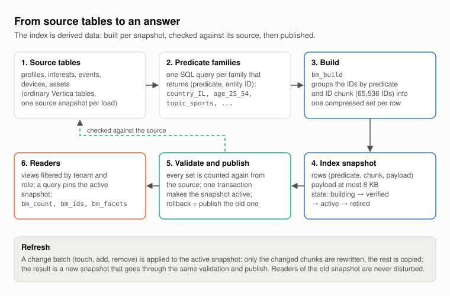

### The idea in three steps

1. **Describe each condition as a query.** A catalog table (`bitmap_demo.bitmap_family`) holds one
   SQL query per family of conditions. The query returns pairs of (condition name, entity ID):
   the family "topic", for example, returns `('topic_sports', 4711)` for every person who likes
   sports. Your own conditions are added the same way.
2. **Build the sets.** For every condition and every block of 65,536 IDs (a "chunk"), a function
   compresses the IDs into one Roaring set and stores it as one row of an ordinary Vertica table:
   `(predicate, chunk_id, payload)`. A payload is at most 8,208 bytes in a `VARBINARY(16384)`
   column, any 64-bit ID works, and on a cluster the work spreads over the nodes by chunk.
3. **Ask with an expression.** A question is the names of the conditions joined by `&` (and),
   `|` (or), `-` (and not), `^` (one or the other, not both) and parentheses. One function call
   evaluates the whole expression in a single pass over the sets:

   ```sql
   SELECT SUM(cnt) FROM (
     SELECT vbitmap.bm_count(chunk_id, predicate, payload USING PARAMETERS expr =
              'country_IL & age_25_54 & consent_true & suspended_false & (topic_sports | topic_finance)')
            OVER (PARTITION BY chunk_id)
     FROM bitmap_demo.v_bitmap_index
     WHERE tenant_id = 10 AND domain = 'person' AND snapshot_id = 1
       AND predicate IN ('country_IL','age_25_54','consent_true','suspended_false','topic_sports','topic_finance')) t;
   ```

   The same question from the shell:
   `scripts/bmq --tenant=10 'country_IL & age_25_54 & consent_true & suspended_false & (topic_sports | topic_finance)'`.
   (The condition names are those of the demo data, where `country_IL` is the set of one country.)

### The functions

All 24 live in schema `vbitmap`. They come in five small groups.

**1. Asking questions.** These five read the index rows `(chunk_id, predicate, payload)` and take
the question as the parameter `expr`. Each is called `OVER (PARTITION BY chunk_id)`.

| Function | How you call it | What it gives you |
|---|---|---|
| `bm_count` | `bm_count(chunk_id, predicate, payload USING PARAMETERS expr='...')` | **How many.** The number of members in each chunk; add them up with `SUM` |
| `bm_ids` | `bm_ids(chunk_id, predicate, payload USING PARAMETERS expr='...' [, max_ids=N] [, text=true])` | **Who.** One row per member ID: as an integer for joins and `INSERT ... SELECT`, or with `text=true` as text, the faster form for sending rows to a client |
| `bm_ids_text` | `bm_ids_text(chunk_id, predicate, payload USING PARAMETERS expr='...' [, sep=E'\n'])` | **Who, in bulk.** The same list as text blocks of up to 65,000 bytes, one ID per line: the fastest way to hand a long list to a client |
| `bm_facets` | `bm_facets(chunk_id, predicate, payload USING PARAMETERS expr='...', facets='topic_' [, exclude='topic_'])` | **The breakdown.** The size of the audience inside every set whose name starts with the prefix (all 500 topics, for example), in the same single pass |
| `bm_eval` | `bm_eval(chunk_id, predicate, payload USING PARAMETERS expr='...')` | **The audience itself**, as a set per chunk, to store and use as a condition later |

**2. Building sets.**

| Function | How you call it | What it does |
|---|---|---|
| `bm_build` | `bm_build(key_1, ..., key_n, local_id) OVER (PARTITION BY key_1, ..., key_n)` | Makes one set from the IDs of each group of rows (`local_id` is the ID inside its chunk: `entity_id & 65535`). Runs fenced or unfenced |
| `bm_union` | `bm_union(key_1, ..., key_n, payload) OVER (PARTITION BY key_1, ..., key_n)` | Merges many sets into one: the days of a week, or the pieces of a live index |
| `bm_build_agg` | `SELECT ..., bm_build_agg(local_id) ... GROUP BY ...` | The same set as `bm_build`, written as an aggregate: Vertica groups on every thread without sorting. This is the fast builder (unfenced deployments) |
| `bm_union_agg` | `SELECT ..., bm_union_agg(payload) ... GROUP BY ...` | The aggregate form of `bm_union` (unfenced deployments) |

**3. Working with stored sets directly.**

| Function | How you call it | What it does |
|---|---|---|
| `bm_and`, `bm_or`, `bm_xor`, `bm_andnot` | `bm_and(a, b)` | The set operation on two stored sets; the result is a set |
| `bm_cardinality` | `bm_cardinality(a)` | The size of a set |
| `bm_and_cardinality` | `bm_and_cardinality(a, b)` | The size of an intersection, without building it |
| `bm_contains` | `bm_contains(a, local_id)` | Is this ID in the set? |
| `bm_to_ids` | `bm_to_ids(chunk_id, payload) OVER (PARTITION ROW)` | The members of a stored set, one row per ID |
| `bm_pair_count` | `bm_pair_count(name, a, b) OVER (PARTITION BEST)` | The intersection count of each pair of sets. Its rows are independent, so Vertica spreads them over every thread of the query: breakdowns for a single user who has the whole machine |

**4. An audience as a filter on any table (pinned sets).**

| Function | How you call it | What it does |
|---|---|---|
| `bm_pin` | `bm_pin(chunk_id, predicate, payload USING PARAMETERS expr='...', name='aud') OVER ()` | Evaluates the question and keeps the audience in memory for the session, under a name. A second form, `bm_pin(chunk_id, payload USING PARAMETERS name='aud') OVER ()`, pins a set that is already stored |
| `bm_member` | `... WHERE bm_member(entity_id USING PARAMETERS name='aud')` | Tests every row of any table against the pinned audience while the table is scanned, on every thread. No ID list and no join: this is how an audience meets columns that are not indexed |
| `bm_unpin` | `bm_unpin('aud')` | Releases the pinned set |

**5. Housekeeping.** `bm_empty(USING PARAMETERS chunk_bits=16)` returns the empty set,
`bm_info(a)` describes a stored set (format, size, bytes), and `bm_version()` reports the library
and its build.

### The programs

| Program | How you run it | What it does |
|---|---|---|
| `make`, `make deploy` | `make && make deploy` (`make deploy FENCED=no` for unfenced; `scripts/deploy.sh --undeploy` removes everything) | Compiles the library and installs the functions with `CREATE LIBRARY` |
| `scripts/snapshot.sh` | `scripts/snapshot.sh build --tenant=N --domain=person --watermark='...' --daily --publish`; also `apply`, `validate`, `publish`, `purge`, `discard`, `status` | The validated index: builds a snapshot, checks every set against its source, publishes it in one transaction, applies change batches, rolls back |
| `scripts/live_index.sh` | `scripts/live_index.sh create`, then `load --tenant=N`; also `projections`, `status`, `drop` | The live index: tables whose live aggregate projections hold the sets, so every load keeps them current |
| `scripts/bmq` | `scripts/bmq --tenant=N 'EXPRESSION'` with `--mode=count`, `--mode=ids` or `--mode=facets --facets=topic_` | Asks a question from the shell. `--echo_only` prints the SQL it would run; `--mode=native-count` answers the same question from the source tables, as a check |
| `scripts/generate.sh` | `scripts/generate.sh --tenant=N --snapshot=1 --small` (or `--default`, `--large`) | Seeded test data, generated inside Vertica: 1, 10 or 100 million people |
| `scripts/demo.sh` | `scripts/demo.sh` (`--size=default` for 10 M people, `--pause` for a presentation) | The five-minute tour: build, query, breakdown, IDs, refresh, rollback |
| `make test`, `tests/sql/run_all.sh` | as written | The engine's unit tests, and eight SQL test suites that run with the functions fenced and unfenced |
| `bench/reproduce.sh` | `bench/reproduce.sh --size=small --no-limits`, or with no option for the article's protocol | Measures the bitmap benchmark of this article again, from an empty tenant to a report |

### What turns the functions into a database

- **Fenced or unfenced.** Vertica runs the functions in one of two ways, and this article always
  says which one a number belongs to. *Fenced*, the functions run in a separate process, so a fault
  in the extension cannot touch the server; this is how `make deploy` installs them. *Unfenced*,
  they run inside the server, the way ClickHouse runs its own built-in functions; the comparison
  with ClickHouse therefore uses the unfenced numbers and shows the fenced ones next to them.
- **A snapshot lifecycle.** The index is derived data, so every set belongs to an immutable snapshot
  that is checked against its source before anyone can read it, then published in one transaction.
  Readers pin a snapshot; a publish never disturbs a running query; rollback is a publish of the
  previous snapshot. Incremental refresh applies a change batch (touch, add, remove) to the published
  snapshot and validates the result. The sets are built by the transform function `bm_build`, fenced
  or unfenced, or by the aggregate `bm_build_agg`, which groups the membership rows on every thread
  of the query without sorting them (unfenced; `snapshot.sh build --aggregate`). Both write the
  same bytes.
- **Readers see views, not tables**, filtered by tenant and role, so the existing Vertica security
  model governs the index.
- **Two projections of the index table.** One is sorted by predicate (fast look-up of single sets),
  one by ID chunk, so that a whole expression is evaluated chunk by chunk without sorting the sets
  first. The second one has a story of its own ("The fourteen-second mystery" below).
- **Numeric attributes as bit slices.** A number can be stored as one set per bit (`age_bit_0` ...
  `age_bit_7`). The sum of the attribute over any audience is then a weighted sum of set counts, in
  the same single `bm_facets` pass and without touching the profile table; the same sets serve as
  range predicates.
- **A live index.** For facts that are only ever added (tags, interests, events) the sets can be a
  live aggregate projection of the fact table itself: `bm_build` runs on the rows of every load,
  `bm_union` merges the pieces. There is nothing to build, schedule or validate; a query reads the
  projection by its name with the same functions.
- **Tested like a database feature.** The engine library is covered by unit tests, sanitizers and
  600-second fuzzing runs of the payload parser and the expression parser; the SQL layer has eight
  test suites that run with the functions fenced and unfenced.

That is the whole design: sets in ordinary tables, functions that combine them, and two ways to keep
them current. Now it had to prove itself.

## The rules of the test

A benchmark is worth something only if the loser would accept it. These rules were fixed before
the first run, and every script and every raw result is in the repository:

- **One machine, one engine at a time.** Intel Core Ultra 7 165H, 64 GB RAM, Ubuntu 26.04, Vertica
  26.3.0-2, single node; ClickHouse 26.8.36.3. The engine under test runs in a cgroup limited to 20
  CPUs and 56 GiB (no swap), the other engine is stopped, and the benchmark client runs on the two
  remaining CPUs and is checked for saturation in every run.
- **The same rows in both engines.** ClickHouse was loaded with the rows exported from Vertica. Its
  sets are `groupBitmap` sets built from the same definitions (one set per predicate, IDs as 32-bit
  integers, which this data set's dense IDs allow), with `max_threads` 20 and 50 GiB of server
  memory. Both engines ran with the settings stated here and no further tuning.
  <!-- runs 70-72 -->
- **Exact answers only.** Vertica's plain SQL is the reference. Every execution of every path of
  both engines is compared with it (row count and SHA-256 of the sorted rows); a run with a single
  mismatch or error is marked invalid and kept.
- **Vertica's plain SQL gets its best chance.** It ran on hand-tuned projections *and* on the
  projections of Vertica's Database Designer (comprehensive design for the workload); the faster of
  the two is reported per query. The Designer won 14 of 15 queries. <!-- runs 39-41 -->
- **Warm runs**, median (p50) of 15 to 30 measured executions per query for one client and of 32
  to 64 for 32 clients, after a warm-up. In the later runs every statement has a time limit; a
  statement that passes it is recorded as a failure, never dropped. Two tests, the ID list as text
  rows and the audience as a row filter, ran three times; the article reports the middle run.
- **Both engines are timed the same way.** The benchmark client speaks each engine's wire protocol
  itself, sends a statement and stops the clock when the last byte of the answer has arrived; the
  rows are decoded and compared with the reference after the measured block. Why this rule exists
  is a story of its own ("The case of the slow list" below).
  <!-- runs 154-161, 170-174; earlier runs read through vsql: 90, 94, 103, 132 -->
- **Data:** a seeded generator. Default scale: 10 million people, 200 million interest rows (500
  topics, skewed), 100 million events over 30 days, 2 million devices, 5 million assets. Large
  scale: ten times each.
- **A failure for lack of memory has one meaning, for either engine:** this node is too small for
  that test. No other conclusion is drawn from it.

## Test one: Vertica against its own SQL

**The question.** Before meeting the specialist, the bitmap database has to beat the engine it
lives in. Is a set index inside Vertica faster than Vertica's own tuned SQL, and by enough to
matter?

Six questions were asked of 10 million people, each one a real task: the marketer's count, the
distinct users of each day, the audience split by all 500 topics, the ranking of 499 topics by
their overlap with sports, the list of 530,315 people behind an audience, and a short list of
devices that stands for the kind of query a sorted projection already answers.

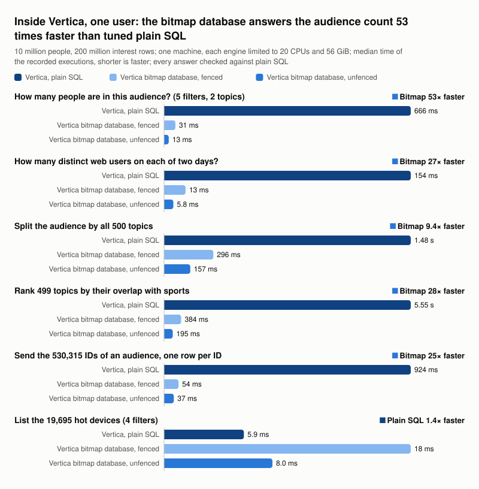

| One user, 10 M people | Vertica, plain SQL | Vertica bitmap, fenced | Vertica bitmap, unfenced | Faster |
|---|---:|---:|---:|---|
| How many people are in this audience? (Q1) | 666 ms | 31 ms | **13 ms** | **Bitmap, 53×** |
| Distinct web users on each of two days (Q2) | 154 ms | 13 ms | **5.8 ms** | **Bitmap, 27×** |
| The audience split by 500 topics (Q3) | 1,481 ms | 296 ms | **157 ms** | **Bitmap, 9.4×** |
| 499 topics ranked by overlap with sports (Q7) | 5,551 ms | 384 ms | **195 ms** | **Bitmap, 28×** |
| The 530,315 IDs of an audience, one row per ID (Q8) | 924 ms | 54 ms | **37 ms** | **Bitmap, 25×** |
| The 19,695 hot devices (Q4) | **5.9 ms** | 18 ms | 8.0 ms | Plain SQL, 1.4× |

<!-- plain SQL: runs 22, 28, 40 (faster per query), Q8 and Q4: run 197; bitmap fenced runs 157, 158,
     185; unfenced runs 170, 171, 187; Q3 and Q7: the faster of the one-pass and the every-thread
     form (section "One user, every thread"); Q8 unfenced: IDs as text rows, middle of runs 222,
     278, 293 -->

Now the same six questions from 32 clients at the same time:

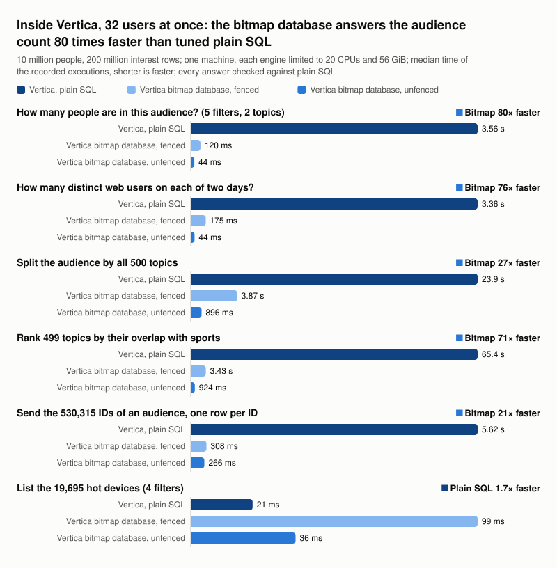

| 32 users at once, 10 M people | Vertica, plain SQL | Vertica bitmap, fenced | Vertica bitmap, unfenced | Faster |
|---|---:|---:|---:|---|
| How many people are in this audience? (Q1) | 3,558 ms | 120 ms | **44 ms** | **Bitmap, 80×** |
| Distinct web users on each of two days (Q2) | 3,363 ms | 175 ms | **44 ms** | **Bitmap, 76×** |
| The audience split by 500 topics (Q3) | 23,878 ms | 3,869 ms | **896 ms** | **Bitmap, 27×** |
| 499 topics ranked by overlap with sports (Q7) | 65,398 ms | 3,433 ms | **924 ms** | **Bitmap, 71×** |
| The 530,315 IDs of an audience, one row per ID (Q8) | 5,622 ms | 308 ms | **266 ms** | **Bitmap, 21×** |
| The 19,695 hot devices (Q4) | **21 ms** | 99 ms | 36 ms | Plain SQL, 1.7× |

<!-- plain SQL: runs 23, 29, 41 (faster per query), Q8 and Q4: run 197; bitmap fenced runs 157, 158;
     unfenced runs 170, 171; Q8 unfenced: IDs as text rows, middle of runs 222, 278, 293 -->

Two things in these tables deserve a sentence each.

The device query goes to plain SQL at both levels, and it should: a sorted projection already
isolates its 19,695 rows, and a bitmap query spends its first milliseconds starting the function.
The index is for set questions; it complements SQL (section "When plain SQL is the better tool").

And at 32 users, four plain SQL executions stopped with `ERROR 3814: Join inner did not fit in
memory` (the breakdown on the hand-tuned projections, once in each of two runs, and a
retention-grid query on the Database Designer projections, twice). By the rule above that means
one thing: this node (20 CPUs, 56 GiB) is too small for 32 of those joins at once. The bitmap
paths completed every execution of every run at this scale.
<!-- runs 23, 29, 41; bitmap runs 90, 94, 105, 107: errors=0 -->

**The filters can be anything.** One fast query is not enough when filters are changed
interactively. The bitmap path costs about the same whatever the audience: 43 to 84 ms for one
user, for selectivities from 0.01 % to 49 % and expressions of 2 to 32 terms. Plain SQL written
from the same expressions took 418 to 1,169 ms; with 32 users 342 to 671 ms against 7.2 to 13.2 s.
<!-- run 31, fenced, before the second projection -->

**Verdict.** Inside Vertica the bitmap database answers set questions 9 to 53 times faster than
tuned plain SQL for one user and 21 to 80 times faster for 32 users, with identical answers. The
first half of the claim holds. That was the easy opponent.

## Test two: Vertica against the specialist

**The question.** ClickHouse has Roaring bitmap aggregates built into the product. On the same
machine, with the same rows and the same limits, are its bitmap functions faster than Vertica's
bitmap database? If they are, the second system is justified.

The first number was a warning. ClickHouse's *plain SQL*, with no bitmap at all, answered the
marketer's count in 199 ms. Vertica's tuned plain SQL had needed 666 ms. On five of the six
questions ClickHouse's plain SQL was faster than Vertica's plain SQL. The specialist was three
times ahead before it had used its special weapon. <!-- runs 103, 155; Vertica runs 40, 197 -->

Then it used it: ClickHouse's bitmap functions answered the count in 42 ms. And then came the
number that decides the claim.

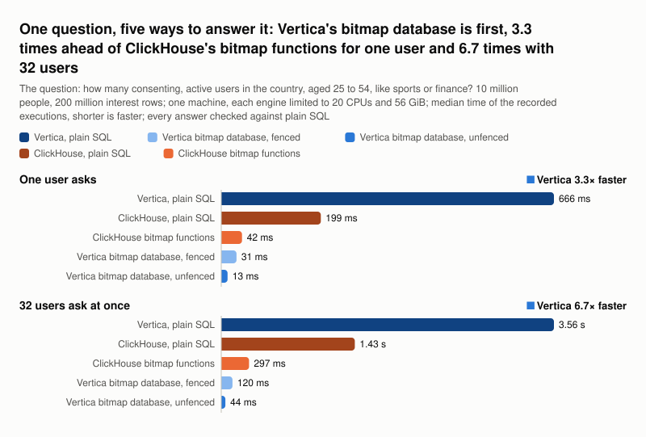

Vertica's bitmap database answered the same question on the same data in **13 ms**: 3.3 times
faster than ClickHouse's bitmap functions. Even fenced, in its safe mode, Vertica answered in
31 ms. We had not expected that, so we raised the pressure to 32 users at once. ClickHouse's
bitmap functions: 297 ms. Vertica's bitmap database: **44 ms**, 6.7 times faster. The lead grows
with the crowd. <!-- runs 170, 157, 103 -->

All six questions, one user:

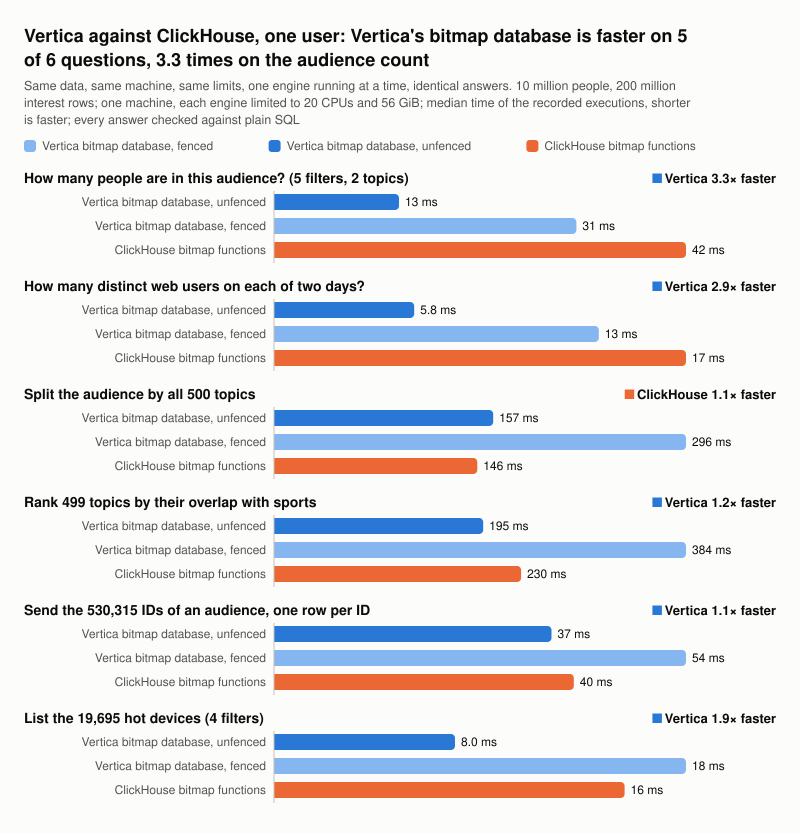

| One user, 10 M people | Vertica bitmap, unfenced | Vertica bitmap, fenced | ClickHouse bitmaps | ClickHouse, plain SQL | Faster (bitmaps) |
|---|---:|---:|---:|---:|---|
| How many people are in this audience? (Q1) | **13 ms** | 31 ms | 42 ms | 199 ms | **Vertica, 3.3×** |
| Distinct web users on each of two days (Q2) | **5.8 ms** | 13 ms | 17 ms | 33 ms | **Vertica, 2.9×** |
| The audience split by 500 topics (Q3) | 157 ms | 296 ms | **146 ms** | 435 ms | ClickHouse, 1.1× |
| 499 topics ranked by overlap with sports (Q7) | **195 ms** | 384 ms | 230 ms | 1,478 ms | **Vertica, 1.2×** |
| The 530,315 IDs of an audience, one row per ID (Q8) | **37 ms** | 54 ms | 40 ms | 210 ms | **Vertica, 1.1×** |
| The 19,695 hot devices (Q4) | **8.0 ms** | 18 ms | 16 ms | 14 ms | **Vertica, 1.9×** |

And with 32 users at once:

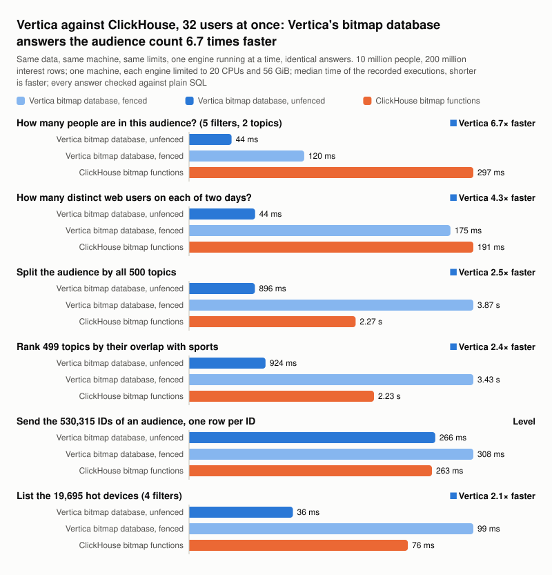

| 32 users at once, 10 M people | Vertica bitmap, unfenced | Vertica bitmap, fenced | ClickHouse bitmaps | ClickHouse, plain SQL | Faster (bitmaps) |
|---|---:|---:|---:|---:|---|
| How many people are in this audience? (Q1) | **44 ms** | 120 ms | 297 ms | 1,429 ms | **Vertica, 6.7×** |
| Distinct web users on each of two days (Q2) | **44 ms** | 175 ms | 191 ms | 551 ms | **Vertica, 4.3×** |
| The audience split by 500 topics (Q3) | **896 ms** | 3,869 ms | 2,266 ms | 14,463 ms | **Vertica, 2.5×** |
| 499 topics ranked by overlap with sports (Q7) | **924 ms** | 3,433 ms | 2,233 ms | 20,636 ms | **Vertica, 2.4×** |
| The 530,315 IDs of an audience, one row per ID (Q8) | 266 ms | 308 ms | 263 ms | 1,722 ms | level |
| The 19,695 hot devices (Q4) | **36 ms** | 99 ms | 76 ms | 165 ms | **Vertica, 2.1×** |

<!-- Vertica unfenced runs 170, 171, 187; fenced runs 157, 158, 185; Q8 one row per ID (text rows):
     middle of runs 222, 278, 293; ClickHouse runs 103 (Q1, Q2, Q3, Q7), 154, 155 (Q4, Q8 SQL),
     234 (Q8 bitmaps, with run 222). Q3 and Q7 of Vertica: the faster of its two forms. -->

What the two tables say:

- **Counts and daily distinct users go to Vertica**, by 2.9 to 3.3 times for one user and 4.3 to
  6.7 times for 32. Fenced, Vertica is still ahead of ClickHouse on both at both levels.
- **Breakdown and overlap with 32 users go to Vertica**, by 2.4 to 2.5 times (0.9 s against 2.2 s).
- **For a single user the breakdown goes to ClickHouse** (146 ms against 157 ms) and the overlap
  ranking to Vertica (195 ms against 230 ms). Fenced, Vertica's breakdowns take 0.3 to 3.9 s and
  ClickHouse's bitmaps are ahead of them.
- **Why the lead grows with the number of users.** Vertica's expression functions walk through the
  sets of one question in a single pass, on a single thread, and leave the other cores to the other
  31 users. For the single analyst who wants the whole machine, breakdowns have a second form that
  uses every thread (section "One user, every thread"); the tables show the faster form.
- **ClickHouse's plain SQL** is 2 to 6 times slower than its own bitmaps on five of the six
  questions, so the comparison that matters is bitmaps against bitmaps. Its SQL overlap query ran
  out of memory in 60 of 64 executions at 32 clients (`MEMORY_LIMIT_EXCEEDED`): as with Vertica's
  joins in test one, the node is too small for 32 such queries at once, nothing more. The bitmap
  paths of both engines completed every execution. <!-- run 103 -->

**Verdict.** On the specialist's own ground, bitmaps against bitmaps, Vertica is faster on 5 of 6
questions for one user and on 5 of 6 for 32 users, where the sixth is level. The second half of
the claim holds for the core questions.

### The fourteen-second mystery

It was not always like that. In an early run the 500-topic breakdown for 32 users took Vertica's
bitmap functions **14.4 s**. Something was badly wrong, and it was not the code.

The first version stored the index sorted by predicate only. Evaluating an expression chunk by
chunk needs the sets of each chunk together, so Vertica sorted them for every query: unnoticeable
for six sets, expensive for 500, and at 32 clients the sorts competed for memory. The fix was one
statement, a second projection of the same table sorted by chunk:

| 32 users at once, Vertica bitmap, fenced | Index sorted by predicate | Plus a projection sorted by chunk |
|---|---:|---:|
| How many people are in this audience? (Q1) | 389 ms | **121 ms** |
| The audience split by 500 topics (Q3) | 14,412 ms | **3,503 ms** |
| 499 topics ranked by overlap with sports (Q7) | 18,532 ms | **3,575 ms** |

<!-- runs 88, 90 -->

Not one function changed. The price is storage: the index is kept twice (4.43 GB next to 4.42 GB
with both scales loaded), and the projection took 62 s to create. <!-- runs 89, 98 -->

**The finding.** In Vertica the first tuning tool is the projection. Look there before writing
code.

## Test three: the people behind the count

**The question.** Sometimes the answer is not a number but the people themselves: 530,315 IDs.
Which engine hands them over faster, and which one does more with them?

This is the test we lost first. In the first measurement ClickHouse delivered the list in 38 ms
and Vertica in 96 ms. <!-- Vertica run 94 (unfenced, read through vsql), ClickHouse run 103 -->

### The case of the slow list

We could have reported that number and moved on. We took it apart instead. Producing the 530,315
IDs inside Vertica takes 19 ms. So where did the other 77 ms go? <!-- run 172 -->

On the road. Half a million IDs travelled as half a million separate rows, and the command-line
client (`vsql`) formatted every one of them: for an answer of this size the client program cost
about as much as the query. Two changes followed:

- **Both engines are timed the same way** (the rule above): the clock stops at the last byte on
  the wire, and the rows are decoded afterwards. A benchmark should measure engines, not client
  programs.
- **The function formats the ID.** With `text = true`, `bm_ids` hands each ID to Vertica as text.
  The rows on the wire are the same bytes, and the list arrives in 37 ms instead of 46 ms. A
  second function, `bm_ids_text`, returns the list as text blocks of up to 65,000 bytes, one ID per
  line: 153 rows instead of 530,315, the same bytes for a client that writes them to a file.
  <!-- middle of runs 222, 278, 293: text rows 34.6, 37.2, 36.6 ms and 263, 266, 281 ms; INT rows
       42.6, 45.6, 47.9 ms; ClickHouse runs 234, 154 -->

Measured again, the same list reaches a user in **37 ms from Vertica and 40 ms from ClickHouse**.

### Seven things to do with a list

What matters is what happens to the list next, so each use was measured on its own:

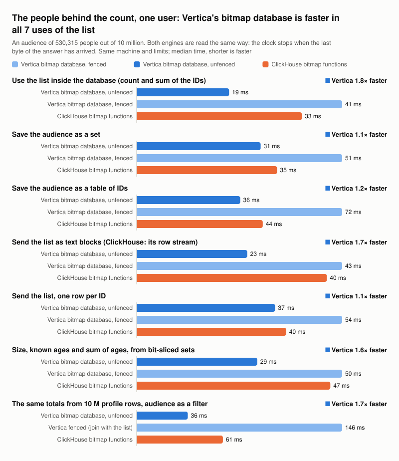

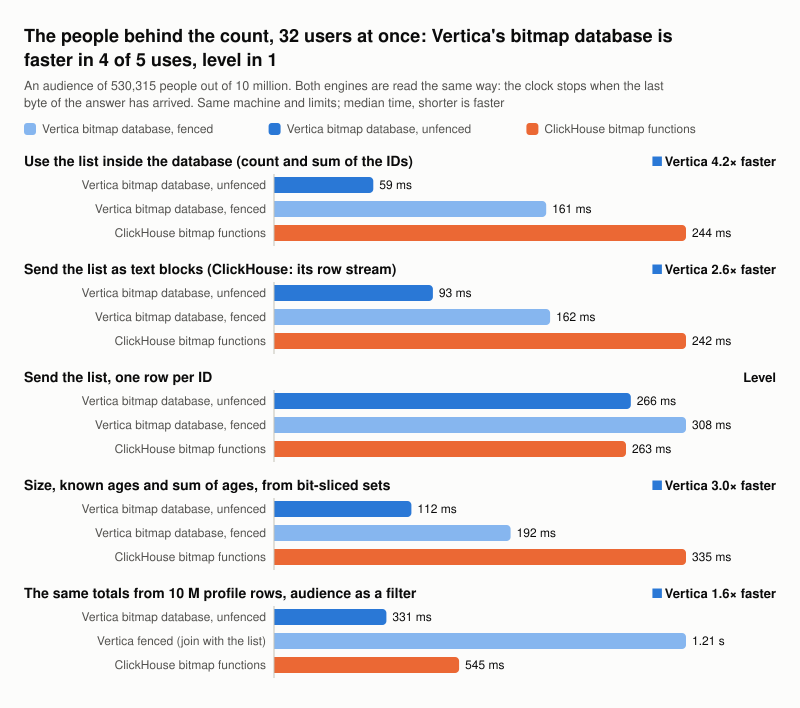

Median times for 1 user / 32 users:

| What happens to the 530,315 IDs | Vertica bitmap, unfenced | Vertica bitmap, fenced | ClickHouse bitmaps | Faster |
|---|---:|---:|---:|---|
| Used inside the database (count and sum of the IDs) | **19 / 59 ms** | 41 / 161 ms | 33 / 244 ms | **Vertica, 1.8× / 4.2×** |
| Saved as a set (1 user) | **31 ms** | 51 ms | 35 ms | **Vertica, 1.1×** |
| Saved as a table of IDs (1 user) | **36 ms** | 72 ms | 44 ms | **Vertica, 1.2×** |
| Sent as text blocks (`bm_ids_text`; ClickHouse: its row stream) | **23 / 93 ms** | 43 / 162 ms | 40 / 242 ms | **Vertica, 1.7× / 2.6×** |
| Sent one row per ID | **37** / 266 ms | 54 / 308 ms | 40 / 263 ms | **Vertica, 1.1×** / level |
| Size, known ages and sum of ages of the audience, from bit-sliced sets | **29 / 112 ms** | 50 / 192 ms | 47 / 335 ms | **Vertica, 1.6× / 3.0×** |
| The same three totals from the 10 M profile rows, the audience as a row filter | **36 / 331 ms** | 146 / 1,212 ms (join) | 61 / 545 ms | **Vertica, 1.7× / 1.6×** |

<!-- Vertica unfenced runs 171, 172, 174, 210; fenced 158, 159, 161, 213, 220; one row per ID (text
     rows): middle of runs 222, 278, 293 (34.6, 37.2, 36.6 ms; 263, 266, 281 ms); row filter: middle
     of runs 223, 279, 294 (33.2, 36.2, 36.4 ms; 328, 344, 331 ms); ClickHouse runs 154, 133, 134,
     216, and again together with the new Vertica forms: 234 (one row per ID), 235 (row filter with
     bitmapContains) -->

What this shows:

- **Most lists never leave the database, and there Vertica is furthest ahead.** Counted, saved or
  fed to the next statement: 1.8 times faster than ClickHouse for one user and 4.2 times for 32.
- **Attributes of the audience need no join.** With the age stored as bit-sliced sets (one set per
  bit of the value), the size of the audience, the number of its members with a known age and the
  sum of their ages are set counts in one pass: Vertica 29 ms, ClickHouse 47 ms from the same sets.
- **Columns that are not indexed: the audience becomes a row filter.** `bm_pin` evaluates the
  expression and keeps the result in memory for the session; `bm_member(entity_id)` then tests
  every row of the profile table while it is scanned, on every thread, with no ID list and no
  join: Vertica 36 ms, ClickHouse 61 ms, which tests each profile row against its bitmap in the
  same way. <!-- middle of runs 223, 279, 294; ClickHouse run 235 -->
- **The classic form, a semi-join with the ID list,** takes Vertica 123 ms unfenced and 146 ms
  fenced, and ClickHouse 71 ms (925 ms against Vertica's 1.2 s with 32 users). It is the form for
  the fenced deployment, where every row tested would have to cross to the side process; unfenced,
  the row filter replaces it. <!-- runs 223, 220, 235 -->
- **Fenced, ClickHouse is ahead for one user** (33 to 61 ms against Vertica's 41 to 146 ms), and
  Vertica is ahead in three of the five uses measured with 32 users.
- **The shorter lists go to Vertica as well:** the Q1 audience (251,683 IDs) row by row takes
  Vertica 25 / 147 ms unfenced and 48 / 200 ms fenced against ClickHouse's 55 / 372 ms.
  <!-- runs 222, 158, 234 -->

At 32 clients every delivered-list number, of either engine, also contains the two client CPUs.

**Verdict.** The test that was lost first is won: for one user Vertica is faster than ClickHouse
in all seven uses of the list, and for 32 users in four of five, level in the fifth.

## Test four: fresh data, and the index that maintains itself

**The question.** An index is only as good as its freshness. New data must appear without
stopping the readers and without a moment in which the index disagrees with the tables. This is
where we expected the general-purpose database to pay.

It did something we had not planned for. A snapshot is the right form when the source changes in
place and the index must be certified against it. But much audience data is not like that: tags,
interests and events are only ever added. For such tables the index does not have to be built at
all. A live aggregate projection can call the library's own functions, `bm_build` on the rows of
each load and `bm_union` when pieces are merged, so Vertica keeps one set per (chunk, predicate) up
to date inside the transaction that loads the rows:

```sql
CREATE PROJECTION bitmap_live.bitmap_index (tenant_id, snapshot_id, domain, chunk_id, predicate, payload) AS
SELECT tenant_id, snapshot_id, domain, chunk_id, predicate,
       vbitmap.bm_union(sq.part) OVER (PARTITION BATCH BY tenant_id, snapshot_id, domain, chunk_id, predicate) AS (payload)
FROM (SELECT tenant_id, snapshot_id, domain, chunk_id, predicate,
             vbitmap.bm_build(entity_id & 65535)
               OVER (PARTITION PREPASS BY tenant_id, snapshot_id, domain, chunk_id, predicate) AS (part)
      FROM bitmap_live.tag) sq;
```

That statement is the whole index. There is no build job, no schedule and no validation step: the
sets are written by the transaction that writes the rows. The same 10 million people were loaded
this way: 253.6 million tag rows (every predicate of every person) and 100 million events.
<!-- runs 163-166 -->

Then we tested it under fire. While 32 clients ran a mix of counts and breakdowns, about 1 % more
data arrived: 2,000,460 tag rows for 100,023 people, spread over every chunk. ClickHouse, which
keeps live sets with a materialized view, was given the same rows under the same load.

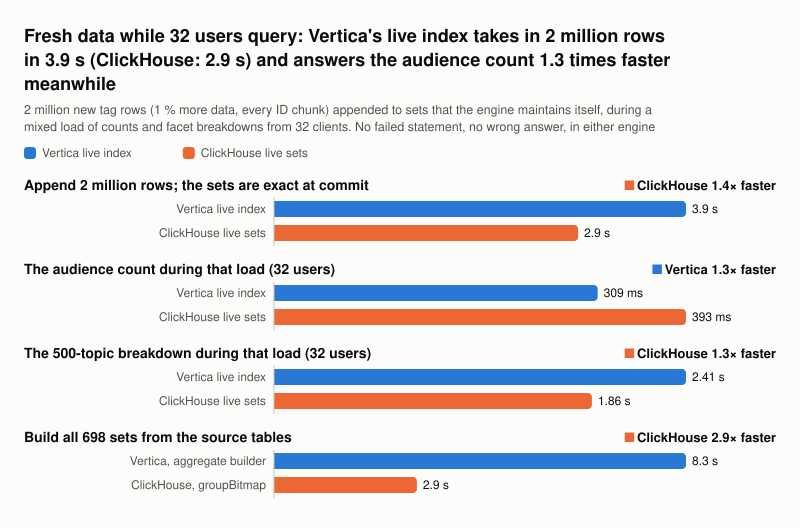

| Fresh data, 10 M people | Vertica live index | ClickHouse live sets | Faster |
|---|---:|---:|---|
| Append 2 million rows while 32 users query | 3.9 s | **2.9 s** | ClickHouse, 1.4× |
| The audience count during that load (32 users) | **309 ms** | 393 ms | **Vertica, 1.3×** |
| The 500-topic breakdown during that load (32 users) | 2.41 s | **1.86 s** | ClickHouse, 1.3× |
| The audience count right after the append, 1 / 32 users | **15 / 64 ms** | 32 / 188 ms | **Vertica, 2.1× / 2.9×** |
| The breakdown right after the append, 1 user | 460 ms | **132 ms** | ClickHouse, 3.5× |
| Build all 698 sets from the source tables | 8.3 s | **2.9 s** | ClickHouse, 2.9× |
| Load all rows with the sets maintained at load time | 92 s | **21 s** plus 3.5 s of merging | ClickHouse, 3.7× |

<!-- runs 179, 138 (append under load), 180, 139 (after the append), 239, 240, 236, 237 (builds),
     166, 136 (maintained load) -->

In both engines the sets were exact when the append committed (Vertica's were checked against
`COUNT(DISTINCT)` on the table), no statement failed and no answer was wrong. ClickHouse is the
faster engine at writing sets: the append, the build from scratch and the maintained load. Vertica
is the faster one at answering the count while the data arrives and right after it. The breakdown
right after an append reads sets that are stored in two pieces until Vertica's background merge
has joined them; afterwards it is back at its usual speed.

What the live index means in practice:

- **Fresh at commit, without a job.** On an idle system the same append takes 0.7 s. Vertica's
  validated snapshot refresh of the same amount of change takes 51 to 110 s. <!-- runs 183, 85-87 -->
- **Queries run at nearly the speed of the built index** (unfenced, median for 1 / 32 users):

| Question, Vertica bitmap, unfenced | Live index | Built index |
|---|---:|---:|
| How many people are in this audience? (Q1) | 16 / 60 ms | 13 / 44 ms |
| Distinct web users on each of two days (Q2) | 8.8 / 54 ms | 5.8 / 44 ms |
| The audience split by 500 topics (Q3), one pass | 331 / 1,158 ms | 264 / 896 ms |
| The 530,315 IDs as text blocks | 24 / 131 ms | 23 / 93 ms |
| The 530,315 IDs used inside the database | 20 / 68 ms | 19 / 59 ms |

<!-- live runs 175-178; built index runs 170-172 -->

- **For facts that are only added.** A table with such a projection takes new rows only (no UPDATE,
  DELETE or MERGE), which is what tags, interests and events are. Attributes that change belong in
  snapshots, and one expression can read both.
- **Run it unfenced.** When the projection is read, Vertica runs the merge function on every set the
  query touches, and unfenced that costs almost nothing (table above). Fenced, each set crosses the
  process boundary twice: the audience count takes 87 ms and the breakdown 4.8 s for one user.
  <!-- run 167 -->
- **The price is paid at load time.** Loading the rows with both projections in place takes 111 s
  against 41 s for the plain load: 70 s of upkeep for 83,691 person sets and 18,360 daily sets, the
  same work the transform builder does in 71 s. Creating the projections over rows that are
  already stored takes 62 s. <!-- runs 163, 164, 166; snapshot build run 58 -->

**Verdict.** Both engines keep live sets exact under load. ClickHouse writes them faster: 2.9 s
against 3.9 s for the append, and 2.9 s against 8.3 s for a build. Vertica answers the audience
count faster while the data arrives, and its index is a projection inside the load's transaction:
there is nothing to run and nothing that can drift.

## Test five: ten times the data

**The question.** Do the bitmap answers hold when the data grows? The same generator at ten times
the scale: 100 million people, 2 billion interest rows, 1 billion events, 20 million devices, on
the same single node. All 14 answers again equal plain SQL. <!-- runs 77, 81 -->

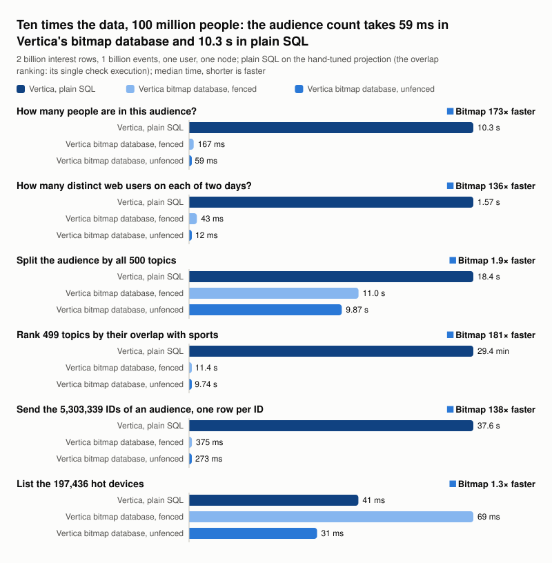

| One user, 100 M people | Vertica, plain SQL | Vertica bitmap, fenced | Vertica bitmap, unfenced | Faster |
|---|---:|---:|---:|---|
| How many people are in this audience? (Q1) | 10.3 s | 167 ms | **59 ms** | **Bitmap, 173×** |
| Distinct web users on each of two days (Q2) | 1.57 s | 43 ms | **12 ms** | **Bitmap, 136×** |
| The audience split by 500 topics (Q3) | 18.4 s | 11.0 s | **9.9 s** | **Bitmap, 1.9×** |
| 499 topics ranked by overlap with sports (Q7) | 29.4 min | 11.4 s | **9.7 s** | **Bitmap, 181×** |
| The 5,303,339 IDs of an audience, one row per ID (Q8) | 37.6 s | 375 ms | **273 ms** | **Bitmap, 138×** |
| The same IDs as text blocks | | 251 ms | **142 ms** | |
| Size, known ages, sum of ages, from bit-sliced sets | 38.1 s | 273 ms | **156 ms** | **Bitmap, 244×** |
| The same totals from the 100 M profile rows | 38.1 s | 1.1 s (join) | **135 ms** (row filter) | **Bitmap, 282×** |
| The 197,436 hot devices (Q4) | 41 ms | 69 ms | **31 ms** | **Bitmap, 1.3×** |

<!-- plain SQL run 82 (3 executions, hand-tuned projection; Q7: single check execution of run 81; Q8
     totals: single oracle execution of run 209; Q4: run 217); bitmap fenced runs 198, 200, 201, 214;
     unfenced runs 203, 205, 206, 211, 224 (one row per ID: text rows), 225 (row filter); Q3 and Q7:
     the every-thread form (one pass: 14.8 s and 14.3 s fenced, 11.2 s and 10.9 s unfenced) -->

Plain SQL ran on the hand-tuned projections at this scale. With 32 clients the audience count takes
Vertica's bitmap database 202 ms unfenced and 612 ms fenced against 132 s for plain SQL, and the
daily distinct count 57 ms and 312 ms against 31.8 s. <!-- runs 204, 199, 81, 83 -->

Two sizing facts at this scale:

- **A breakdown reads the whole index.** Counting 500 topics inside an audience of 100 million
  people reads 840,000 sets (4 GB). It takes 10 to 15 s, 1.2 to 1.9 times faster than plain SQL,
  where the counts, the ID list and the overlap ranking are 136 to 181 times faster.
- **Many breakdowns at once are a matter of memory.** Each one takes about 2 GB of query memory, so
  32 at once ask for more than this node's 45 GiB pool: on the index sorted by predicate the median
  was 6 minutes and 22 of 64 executions were cancelled after waiting 5 minutes for memory
  (`ERROR 3587: Insufficient resources`). That test needs more memory or more nodes. <!-- run 81 -->

Building the index for 100 M people took 14 minutes plus 7.5 minutes of validation with the
transform builder; it occupies 4.0 GB (and 1.0 GB for the daily sets) next to 2.4 GB of interest
rows and 9.9 GB of events. The bit-slice sets of the age took 73 s and 88 MB. The aggregate builder
keeps one 8 KB state per set on every thread; for the daily sets of a billion events in no useful
order that is more memory than this node has, and it finished in the same 15 minutes.
<!-- runs 78, 84, 208, 231 -->

**Verdict.** At ten times the data the lead over plain SQL grows: the count is 173 times faster
(59 ms against 10.3 s), and an overlap ranking of 29 minutes becomes 10 seconds.

## Test six: real-world IDs

**The question.** Customer IDs are rarely dense integers handed out in sign-up order. Does the
index survive random 64-bit IDs? The same 10 M people with such IDs (largest ID
167,125,767,460,479):

| One user, 10 M people | Vertica plain SQL, dense IDs | Vertica plain SQL, 64-bit IDs | Vertica bitmap, dense IDs | Vertica bitmap, 64-bit IDs |
|---|---:|---:|---:|---:|
| How many people are in this audience? (Q1) | 804 ms | 4,392 ms | 49 ms | **63 ms** |
| The audience split by 500 topics (Q3) | 1,611 ms | 5,090 ms | 860 ms | **866 ms** |
| The IDs of an audience (Q8) | 3,776 ms | 4,393 ms | 137 ms | **155 ms** |

<!-- runs 22, 54, 55: fenced, hand-tuned plain SQL projection, before the second index projection,
     for both tenants; random order: run 49 -->

The index has the same size (403 MB) and builds in about the same time (74 s against 71 s).

**Verdict.** With random 64-bit IDs Vertica's bitmap path stays within -13 % to +28 % of its speed
on dense IDs, while plain SQL becomes up to 5.5 times slower.

## The verdict

We set out to test a sentence that every vendor says: *one platform can do it all.* For this job
the sentence can now be replaced by measurements.

1. **Vertica does the bitmap job itself.** A small extension and one or two projections add
   high-performance bitmap capabilities to the Vertica you already run. Every one of its answers equalled plain SQL, in every
   execution of every run.
2. **It is the faster choice.** Of 19 audience tests against ClickHouse's own bitmap functions,
   Vertica is faster in 17 and level in one, by up to 6.7 times, and its lead grows with the
   number of users.

What ClickHouse won is stated above where it was measured, and here in one place:

| Where ClickHouse is faster | ClickHouse | Vertica |
|---|---:|---:|
| Building the 698 sets of the three domains | 2.9 s | 8.3 s (aggregate builder), 72 s (transform builder) |
| Loading the rows with sets maintained at load time | 21 s plus 3.5 s of merging | 92 s |
| The live append under load | 2.9 s | 3.9 s |
| Full rebuild of a snapshot under load | 12 s | 153 s including validation |
| The 500-topic breakdown, one user | 146 ms | 157 ms |
| The breakdown under the mixed load | 1.9 s | 2.4 s |
| The breakdown right after an append, until Vertica has merged the stored pieces | 132 ms | 460 ms |
| The semi-join with the ID list, 1 / 32 users | 71 / 925 ms | 123 / 1,192 ms |
| Breakdowns against fenced Vertica, 1 / 32 users | 146 ms / 2.2 s | 296 ms / 3.4 to 3.9 s |
| The long ID list row by row against fenced Vertica | 40 ms | 54 ms |
| The row filter against fenced Vertica (which uses the join) | 61 ms | 146 ms |
| The device list for 32 users against fenced Vertica | 76 ms | 99 ms |
| Plain SQL on five of the six audience questions | 33 to 1,478 ms | 154 to 5,551 ms |

<!-- runs 236, 237 (ClickHouse build, again), 239, 240, 246, 136, 166, 109, 101, 138, 139, 179, 180,
     103, 187, 185, 154, 235, 223, 220, 155, 40, 197 -->

Each Vertica build is followed by 43 s of validation against the source. The sets have the same
size in both engines (392 MB and 403 MB).

**One system instead of two.** With Vertica there is one system to load, secure and operate.
ClickHouse would be a second one, with its own copy of the data (exporting and loading the 312
million rows took 101 s here), its own pipeline to keep that copy in step and its own security
model. In Vertica the sets are a projection of the table, or a snapshot that is validated against
the source and published in one transaction. <!-- run 70 -->

While others say "we can do that too", Vertica was put to the test and delivered: everything on
one platform, and faster.

## Behind the story

The sections below hold the detail for readers who want to check a number, size a system or
understand a design choice. Nothing in them changes the verdict.

### One user, every thread

The expression functions make one pass over the chunks of a query, in order, on one thread. That is
the right shape when many users share the machine, and it is why the counts of test two barely
notice 32 clients. A single analyst waiting for a breakdown by 500 topics would rather have every
core. For that case the facet arithmetic has a second form: the audience of each chunk is computed
once (`bm_eval`), joined to the sets of that chunk, and `bm_pair_count` counts each pair. Its rows
are independent, so it is called `OVER (PARTITION BEST)` and Vertica spreads them over the threads
of the query:

| Vertica bitmap, unfenced, 1 / 32 users | One pass (`bm_facets`) | Every thread (`bm_pair_count`) |
|---|---:|---:|
| The audience split by 500 topics (Q3) | 272 / **892 ms** | **157** / 1,159 ms |
| 499 topics ranked by overlap with sports (Q7) | 276 / **883 ms** | **195** / 1,605 ms |

<!-- run 187; fenced, run 185: Q3 486 / 3,242 and 296 / 4,579 ms, Q7 541 / 3,417 and 384 / 8,241 ms -->

Same answers, a different trade: the second form does more work in total and finishes sooner when
the machine is free; with 32 users the one-pass form is the faster one. Fenced the pattern is the
same (296 ms against 486 ms for one user's breakdown). The tables of tests one, two and five show
the faster form of each.

Vertica reads the storage containers of a table on separate threads, so the layout of the index can
push this further. With the same index stored in 16 containers (table partitions of ten chunks
each) the every-thread form also reads the sets in parallel and one user's breakdown takes
**119 ms**, ahead of ClickHouse's 146 ms. This layout suits a system with a few heavy analysts. For
many concurrent users the single-container layout stays the default: on 16 containers the one-pass
forms merge the containers, and with 32 users the audience count takes 127 ms instead of 45 ms and
the breakdown 1.9 to 2.9 s instead of 0.9 s.
<!-- runs 191, 192; ClickHouse run 103 -->

### What the index costs

The price named at the start: the sets have to be built, stored and kept fresh. Here is what
Vertica's validated snapshots cost at 10 million people.

**Build and storage**

- **Build:** 554 sets for 10 M people and 200 M interests (the seven bit-slice sets of the age
  among them) plus the daily activity sets: **7.6 s** with the aggregate builder, then 42 s of
  validation against the source. The aggregate builder groups the membership rows on every thread
  of the query and runs unfenced. The transform builder, which also runs fenced, sorts the rows
  first and takes 72 s. Both write the same bytes. The 24 device sets take 0.8 s.
  <!-- runs 239, 240, 246; first measurement of the transform builder: run 58 -->
- **Storage:** 403 MB for the person index and 105 MB for the daily sets (twice that with the
  second projection). The six source tables take 1,720 MB with default projections and 906 MB with
  the Database Designer's encodings: the index adds about 30 % to the default-encoded source tables.
  <!-- runs 58, 38, 39 -->
- **Payload encoding:** the sets are stored with Vertica's `ZSTD_FAST_COMP` encoding. Measured side
  by side on two copies of the whole index (10 M and 100 M people together, 9 GB in two
  projections), it writes the index in 53 s instead of 71 s and the daily sets in 6 s instead of
  16 s, and the daily sets take a quarter less space (786 MB against 1,068 MB). Queries cost the
  same on both copies (0.99 times at the median of 48 measurements, 0.92 to 1.17 times); the query
  numbers of this article were measured on the default encoding.
  <!-- runs 274, 275 (the copies), 277-294 (10 M unfenced, two rounds), 295, 296 (100 M), 298, 299 (fenced) -->

**Refresh of a snapshot**

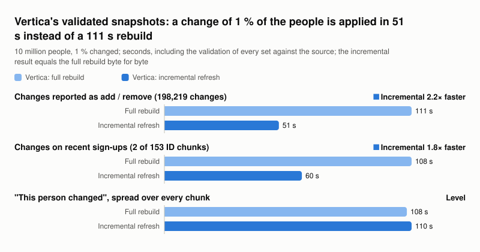

- **Incremental refresh.** A full rebuild of all person sets with validation takes about 50 s with
  the aggregate builder and 110 s with the transform builder, which the following numbers use. A
  change batch of 1 % of the people (100,000 people, 198,219 add/remove changes) is applied to the
  published snapshot in 15 s of index work plus 36 s of validation: **51 s**. A batch concentrated
  on recent sign-ups (2 of 153 ID chunks) takes 60 s. When changes are reported only as "this person
  changed" and are spread over every chunk, each chunk is rebuilt and the incremental path costs
  what a full rebuild costs (110 s). In every case the incremental result equals a full rebuild byte
  for byte, and validation re-counts every set from the source. <!-- runs 85-87 -->
- **A snapshot that was just written** sits in a storage container of its own next to the older
  storage, and Vertica merges the two streams while it reads: the audience count then takes 20 ms
  for one user and 102 ms for 32, and the breakdown 323 ms and 2.3 s. On the published snapshot,
  whose storage Vertica's Tuple Mover has merged, they take 13 and 45 ms, and 263 ms and 1.1 s.
  <!-- runs 242, 243 -->
- **Refresh while 32 clients query.** While 32 clients ran a weighted mix of the six questions, a 1
  % batch of the worst kind (every chunk rebuilt) was applied, validated and published. Every answer
  stayed correct and no statement failed. Unfenced, the rebuild took 153 s instead of 110 s and
  query latencies rose by 25 to 40 % while it ran (audience count 81 to 101 ms, breakdown 550 to
  756 ms). Fenced, it took 285 s and the short queries roughly doubled (audience count 119 to
  216 ms). ClickHouse rebuilds its sets under the same load in 12 s, without a validation step.
  <!-- runs 101, 99; idle run 87; ClickHouse run 109 -->

**The live index right after a load.** With the 3,060 touched sets stored in two pieces the count
was unchanged (15 / 64 ms); the breakdown, which reads every set, took 460 ms for one user and
3.0 s for 32 until Vertica's background merge had joined the pieces. The snapshot lifecycle adds
what a certified index needs on top of the live form: validation of whole families against the
source, pinned snapshots, history and rollback. <!-- run 180 -->

### When plain SQL is the better tool

The index complements Vertica's SQL; it does not replace it. Three kinds of question stay plain
SQL:

- **Filters that a sorted projection already answers.** The device query (19,695 devices out of 2
  million) runs on a Designer projection sorted on its filter columns: Vertica's plain SQL 5.9 ms,
  Vertica's bitmap path 8.0 ms unfenced and 18 ms fenced; with 32 users 21 ms, 36 ms and 99 ms. It
  is faster than every bitmap path of either engine (ClickHouse's bitmaps: 16 ms and 76 ms).
  <!-- runs 197, 171, 158, 154 -->
- **Single aggregates over one table**, such as counting suspended users: 2.9 ms in plain SQL.
  <!-- run 28 -->
- **Ad-hoc questions on attributes nobody indexed.** The bitmap path answers the predicates that were
  built; everything else is SQL, which is also the reference every bitmap answer is checked against.

### Why inside Vertica

What you keep by staying in the database you already run:

- **One system.** The sets are rows in Vertica tables, queried with Vertica SQL and protected by
  Vertica roles and views. There is one copy of the data, one load path and one security model,
  and the warehouse queries around the audience questions run on the same engine.
- **One engine, several kinds of database.** Vertica is the analytical warehouse first. Companion
  extensions built the same way, as C++ functions called from SQL, add graph analytics
  (`vertica-graph-udx`) and vector search (`vertica-vector-db`). This one adds the bitmap database.
- **Transactions for derived data.** A snapshot is validated against its source and published
  atomically; readers never see a half-built index; rollback is one statement.
- **Mix freely.** A bitmap count can sit in the same query as joins to dimension tables, an ID list
  can feed an `INSERT ... SELECT` or a join in the same statement, and plain SQL remains available
  for everything the index does not cover.
- **The index can be a projection.** With the live form the database maintains the sets itself, in
  the transaction that loads the rows.
- **Fenced or unfenced.** Fenced mode keeps the extension outside the server process and already
  answers the audience count in 31 ms, ahead of ClickHouse's 42 ms. Unfenced mode, for code you
  have tested and trust, is up to 2.5 times faster on short single-user queries and up to 4.3 times
  at 32 clients. Both pass the same test suites. Three things are made for the unfenced deployment:
  the row filter on a pinned set, IDs as text rows, and the aggregate builder.
  <!-- runs 157, 158, 170, 171, 103 -->

### Limits

What to know before you size a system on these numbers:

- Every number here is from a single node. The tables are segmented by chunk, so on a cluster each
  node evaluates its own chunks. The test suites also pass on a five-node Eon-mode cluster (three
  primary and two secondary nodes), fenced and unfenced, and `bench/reproduce.sh --size=small` runs
  there from the data to the report with every answer equal to plain SQL, on a host with 2 CPUs
  and 16 GB of memory. No timing was taken there and no multi-node speed is claimed.
- Both engines ran with the settings stated in "The rules of the test" and no further tuning, so
  read the comparison as two approaches on one machine.
- Chunks hold 2^16 IDs; wider chunks need `VARBINARY(65000)` columns.
- Predicates are defined and built in advance. Numeric attributes use precomputed bands, or bit
  slices when sums and arbitrary ranges are needed.
- A breakdown by facets reads the whole index, so its cost grows with the population
  (10 to 15 s at 100 M people). Size the node, or the cluster, for the number of
  simultaneous breakdowns you expect.
- A validated snapshot of 10 M people takes 8 s to build with the aggregate builder (unfenced; give
  it a resource pool whose budget holds one 8 KB state per set) or 72 s with the transform builder
  (fenced or unfenced), and 42 s to validate. The live index has no build job; its table is
  append-only (rows are added, never updated or deleted) and it is at its best unfenced.
- The expression functions work through the chunks of a query in one pass on one thread, which keeps
  them cheap when many users share the machine. For a single user who wants the whole machine,
  breakdowns and overlaps have a second form, `bm_pair_count`, that uses every thread.
- For long ID lists sent to a client use `bm_ids_text`, or keep the list in the database: both are
  faster than half a million separate rows. When the client needs one row per ID, `bm_ids` with
  `text = true` is the faster form unfenced.
- A pinned set lives in the memory of the node that pinned it, for the session that pinned it. On
  a cluster the row filter has to run where the set is; the semi-join with the ID list works
  everywhere.
- At large scale write a shared sub-result as plain subqueries rather than as a `WITH` clause that
  is read several times; the benchmark's overlap query is written that way.
- Warm-cache numbers; first-query latency after a restart was not part of this comparison.

## Check it yourself

Nobody has to take this article's word for anything. Everything above is in the repository: the
extension, the lifecycle scripts, the tests, the benchmark harness with the exact command chains,
the chart generator, and the raw files of every run
cited here (`results/`). On a Vertica 26.3 node with the C++ SDK:

```bash
make && make tools      # the library and the expression tool (CRoaring is vendored)
make test               # engine unit tests
make deploy             # CREATE LIBRARY and the functions, fenced (FENCED=no: unfenced)
scripts/demo.sh         # 1 M people: build, validate, publish, query, facets, IDs, refresh, rollback
```

The demo creates one tenant in schema `bitmap_demo`, prints every command it runs with its timing,
checks the bitmap answer against plain SQL, and removes its tenant at the end.

To measure the numbers of this article on your own machine, one more command does the work:

```bash
bench/reproduce.sh      # the bitmap benchmark: data, index, plain SQL, bitmap paths, ID lists, refresh, ClickHouse, a report
```

It keeps the raw files of every run, and `bench/reproduce.sh --size=small` goes through every step
in minutes. Your numbers will differ with your hardware; the answers will not.

For your own data, `README.md` shows how to describe your predicates as SQL queries and build an
index over your tables; `scripts/live_index.sh create` sets up the live form (`docs/LIVE.md`).

If your users ask set questions (counts, overlaps, breakdowns, lists), you already own the engine
for them: it is the Vertica that runs the rest of your warehouse. The demo takes five minutes, and
the first audience count that comes back in milliseconds will tell you the rest.

## Disclaimer

This work is a demonstration. It is not an official product or functionality offered by Rocket
Software, and it is provided "as is", without warranties of any kind. All brands and product names,
including Vertica and ClickHouse, are mentioned for reference only and belong to their respective
owners.
